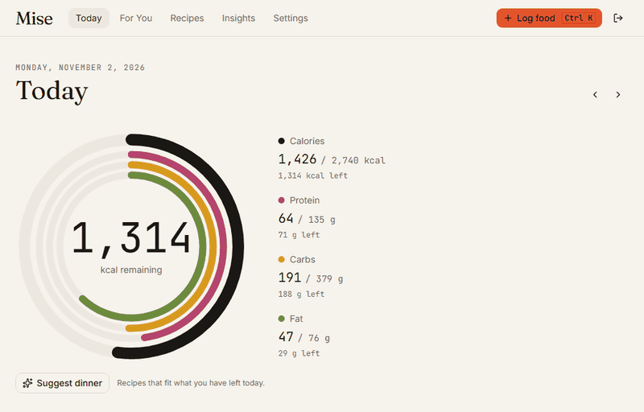
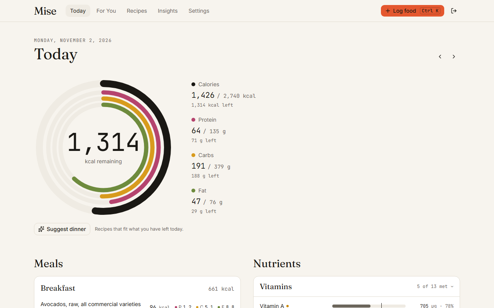
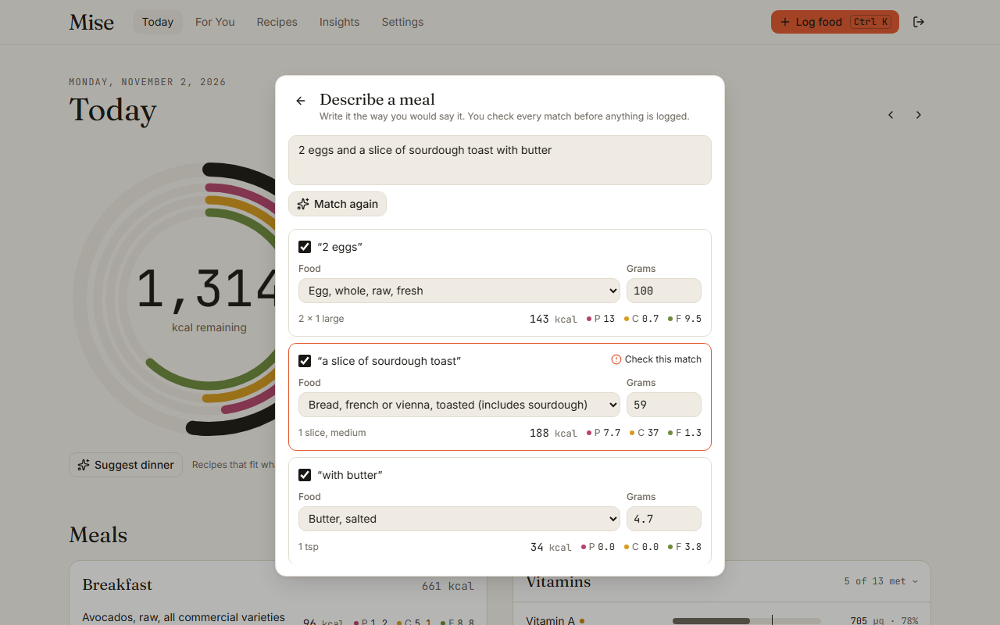
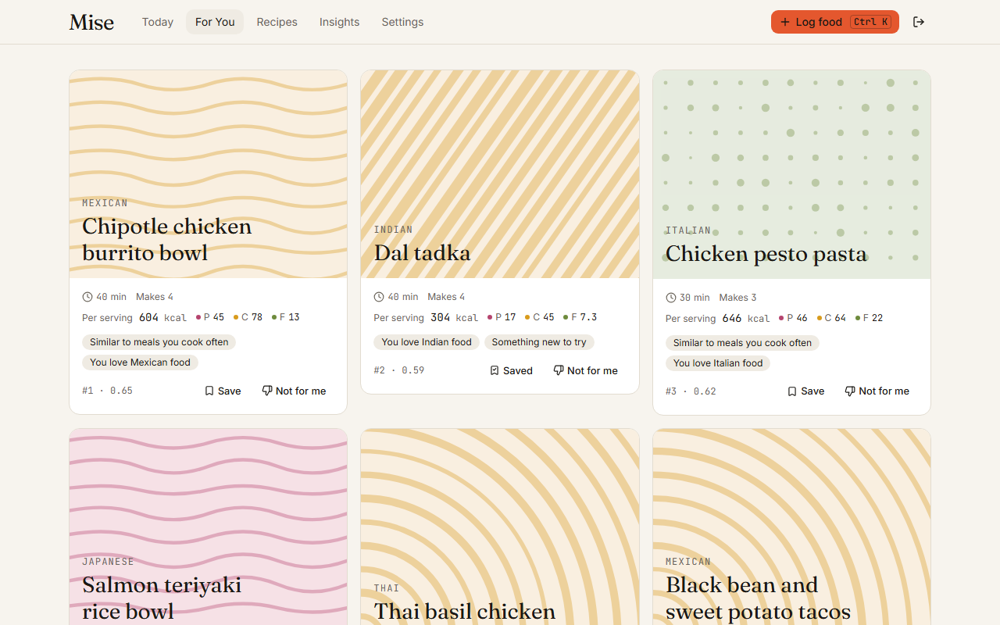
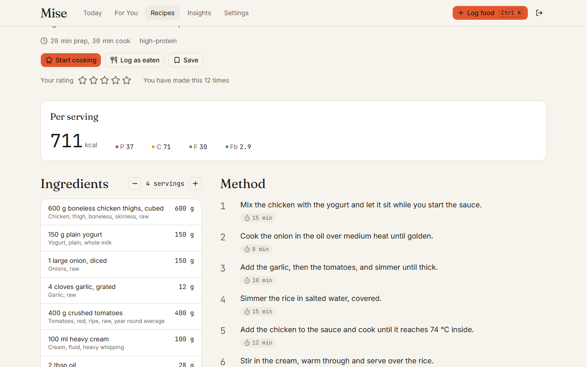
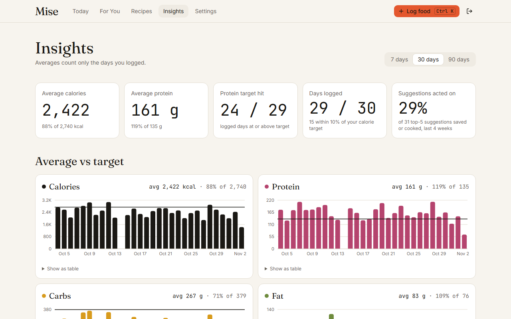

# Mise

A nutrition tracker that uses real USDA data, learns what you like to eat, and walks you through a recipe that fits the rest of your day.

**Live demo:** the Vercel link goes here once the deployment is configured. Every build has a one-click **Try the demo account** button on the login page, with 60 days of realistic history already logged.



## Why I built this

I lift weights and track everything I eat. Cronometer gave me accurate numbers, but it could not tell me what to cook when I had 50 g of protein left at 7 pm, and it did not know that I rotate the same few cuisines every week. I wanted one app that tracks with real USDA data, learns my habits, and walks me through a recipe that fits the rest of my day. Building it was also a way to combine full-stack work, data modeling, a recommendation system and LLM tool use in one product I actually use daily.

## Impact

Mise measures its own usefulness. The private **Impact** panel on Insights computes these from what the app already records (how each entry was logged, how long logging took, and every suggestion shown, saved or cooked):

- Median time to log a food, from opening Quick Log to the entry being saved.
- Days the protein target was hit, out of the days logged.
- Share of dinners that were recipes Mise suggested.
- Share of top-5 suggestions saved or cooked within a week of being shown.

My own numbers go here after a few weeks of daily use. On the demo account the panel shows an 8.4 second median log, and 21% of dinners coming from suggestions.

One number is fixed by design: every nutrient value on screen traces to USDA FoodData Central (or Open Food Facts for scanned packages). The AI never supplies a number.

## Features

**Today.** Calories and macros as a ring, every logged food with its macros, and more than 40 nutrients (vitamins, minerals, fats and amino acids) against your personal targets (Dietary Reference Intakes for your age and sex, or numbers you set yourself). Light and dark themes, designed together.



**Quick Log.** Press Ctrl+K (or the plus button on a phone) to search more than 8,000 USDA foods. Results rank foods you log often first, and portions come from USDA ("1 large egg", "1 cup, chopped"). On a phone, the barcode button opens the camera and scans the product (or type the digits); Open Food Facts fills in the nutrition. If a product is not listed, one tap turns it into a custom food that keeps the barcode, so the next scan finds it.

**Mise score.** Every food in search, My foods and the amount step shows a score from 0 to 100 (Excellent, Good, Poor or Bad), with a breakdown one tap away. Nutrition counts for 60 points, using Nutri-Score; additives of concern for 30, with a high-risk one such as a nitrite capping the score at 49; and an organic label for 10. Additives and labels come from Open Food Facts, so USDA and custom foods are scored on nutrition alone, and the breakdown says so.

**Foods.** A library tab with everything you have built up. My foods keeps every food you have logged or created in one searchable list, sorted by most recent or most logged, and one tap logs it again. Saved meals group foods and recipes you eat together ("Usual breakfast"), so you can log them all at once, scaled to any portion. Save a meal from scratch or straight from a slot on Today. Custom foods and recipes are created from the same tab.

**Plain-English logging.** Describe a meal the way you would say it. Claude splits it into foods; Mise matches each one to USDA data, converts the amount to grams and shows its confidence. Anything under 70% asks you to check it before logging.



**For You.** Recipes ranked by how well one serving fits what is left of your day, how close it is to what you usually cook, and your food rules. Each card says why it was suggested. Allergies and diets are hard filters, never just a lower score.



**Recipes.** Starter recipes plus your own: write one by hand, generate one with Claude for a target ("high protein, under 600 kcal"), or adapt one ("make it dairy free"). Macros are always recomputed from USDA data, and scale with servings.



**Cook Mode.** One step at a time in large type, with arrow keys or swipe, step timers that ring, an ingredient checklist, and the screen kept awake. A cooking assistant answers questions, converts units, starts timers and proposes swaps with the exact macro change before you accept. Finish to log a serving; accepted swaps save as your own version.

**Insights.** Average intake against targets over 7, 30 or 90 days, micronutrient coverage with your top food sources for each, and the Impact panel.



**Installable.** Mise is a PWA. Today stays readable offline from the copy saved on the device.

## Architecture

```
             Browser (PWA)                      Vercel Cron
   Today, Log, Recipes, Cook Mode          nightly taste rebuild
                  |  fetch + stream                 |
  +---------------v---------------------------------v-------------+
  | Next.js on Vercel: route handlers                             |
  |  lib/nutrition      lib/foods      lib/recommend    lib/llm   |
  |  scale, sum,        search, match, candidates,      prompts,  |
  |  targets (pure,     units          score,           Zod,      |
  |  unit-tested)                      diversify,       cook-mode |
  |                                    explain          tools     |
  +-------|----------------|---------------|---------------|-------+
          v                v               v               v
   Supabase Postgres    Claude API      Voyage AI     Open Food Facts
   pgvector, pg_trgm    parse, recipes, embeddings    barcode lookup
          ^             chat
          |
     USDA import (one-time CSV load)
```

The browser and the nightly cron both call the same Next.js route handlers, which check the Supabase session, validate input with Zod and read or write Postgres through Drizzle. Nutrition math lives in one pure, tested module that reads USDA values from Postgres; Claude and Voyage only supply text and embeddings.

## Key design decisions

- **Macros are recomputed on the server, never trusted from the LLM.** When Claude drafts a recipe it names each ingredient and its weight in grams. The server matches every ingredient to a USDA food and computes the nutrition itself. If the result misses the target, Claude gets one revision with the real numbers. A model can describe food well and still be confidently wrong about the protein in it.
- **Ranking is a transparent formula, not an LLM.** Suggestions come from SQL filters, a weighted score and a diversity pass. It is fast, free to run, unit-tested, and every card can say exactly why it ranked where it did.
- **USDA data is imported, not called live.** Foundation and SR Legacy foods load once into Postgres, with trigram and full-text indexes. Search is a local query instead of a network call, recipe nutrition can join food data, and the app does not depend on a third-party API being up.
- **Hard rules stay hard.** Diet, allergies and excluded ingredients filter candidates before scoring. Exclusions expand to whole families, so "shellfish" also removes shrimp and prawns.
- **Diets are sets, not labels.** A diet is the set of animal foods you eat (beef, pork, lamb, chicken, other poultry, fish, shellfish, eggs, dairy, honey). Presets fill the set in one click, and anything between them works: a vegetarian who eats chicken and eggs is just that set. Ingredients are read for hidden animal foods too, so fish sauce counts as fish, gelatin as beef and pork, and pesto as dairy. Generated recipes and Cook Mode swaps are checked against the same rule.
- **Row-level security on every table.** Each user's data is isolated in Postgres itself, not just in application code.
- **The Mise score is computed, not licensed.** Yuka has no public API, so Mise scores foods itself with the same idea: 60% Nutri-Score, 30% additives, 10% organic. Nutri-Score points come from Open Food Facts when it has them, else from the stored nutrients per 100 g, mapped to 0 to 100 linearly between the grade boundaries so near-identical foods never land far apart. A food missing sodium, or sugars or saturated fat it could plausibly contain, gets no score rather than a flattering guess. Category rules (drinks, cheese, added fats) and fruit and vegetable content are only applied when Open Food Facts supplies the points, so USDA cheeses score lower than their official grade.
- **Counts stay honest.** Missing nutrient values are shown as unknown, not zero, and each total says how many foods had data.

## How recommendations work

Candidates are recipes you can see that match the meal slot, your diet and your time limit, and contain nothing you excluded. Each is scored:

```
score = 0.35 M + 0.30 T + 0.15 C + 0.10 N + 0.10 R - D
```

| Term | Meaning            | How it is computed (all 0 to 1)                                         |
| ---- | ------------------ | ----------------------------------------------------------------------- |
| M    | Macro fit          | How close one serving is to this slot's remaining budget                |
| T    | Taste similarity   | Cosine similarity between the recipe and your taste embedding, rescaled |
| C    | Cuisine preference | 1 for cuisines you like, else a weight learned from what you cook       |
| N    | Novelty            | 1 if not cooked in the last 14 days, else days since cooked / 14        |
| R    | Rating             | Your rating / 5, or 0.6 if unrated                                      |
| D    | Dislikes           | 0.15 for each disliked ingredient                                       |

Macro fit is one minus the mean relative error across calories, protein, carbs and fat:

```
M = 1 - (1/4) × Σ min(1, |recipe_k - budget_k| / budget_k)
```

**Worked example.** Your dinner budget is 745 kcal, 50 g protein, 80 g carbs and 25 g fat. One serving has 730 kcal, 45 g protein, 70 g carbs and 30 g fat.

- Calories: 15 / 745 = 0.020
- Protein: 5 / 50 = 0.100
- Carbs: 10 / 80 = 0.125
- Fat: 5 / 25 = 0.200
- Mean error: 0.445 / 4 = 0.111, so M = **0.889**

With taste similarity 0.80, a liked cuisine, not cooked recently and unrated:

```
0.35 × 0.889 + 0.30 × 0.80 + 0.15 × 1 + 0.10 × 1 + 0.10 × 0.6
  = 0.311 + 0.240 + 0.150 + 0.100 + 0.060 = 0.861
```

The two largest terms become the card's reasons: "Fits your remaining dinner macros" and "Similar to meals you cook often".

The top 30 are then reordered with Maximal Marginal Relevance (λ = 0.7) so the list is not ten versions of the same dish. Your taste embedding is a weighted average of what you cook, log, save and rate, with a 30-day half-life, rebuilt nightly and after every cook.

## Tech stack

- **App:** Next.js 15 (App Router), React 19, TypeScript in strict mode
- **UI:** Tailwind CSS 4 with design tokens, shadcn/ui on Radix, Motion, TanStack Query, cmdk, Vaul, Recharts
- **Data:** Supabase (Postgres 17, Auth with email and password or magic links, row-level security), Drizzle ORM, pgvector, pg_trgm
- **AI:** Claude through the Anthropic SDK (structured outputs validated with Zod, streaming tool use in Cook Mode), Voyage AI embeddings
- **Food data:** USDA FoodData Central (Foundation and SR Legacy), Open Food Facts for barcodes
- **Quality:** Vitest, Playwright, axe-core, ESLint, Prettier, Husky, commitlint, GitHub Actions

## Running locally

You need Node 22+, pnpm and a Supabase project.

```bash
pnpm install
cp .env.example .env.local    # fill in the values below
pnpm db:migrate               # schema, row-level security, extensions
pnpm import:usda              # downloads and loads USDA foods (a few minutes)
pnpm seed:recipes             # starter recipes
pnpm retag:diets              # recompute recipe diet tags after rule changes
pnpm demo:user && pnpm seed:demo   # optional: the demo account and its history
pnpm dev
```

Environment variables (see `.env.example`):

| Variable                               | What it is                                               |
| -------------------------------------- | -------------------------------------------------------- |
| `NEXT_PUBLIC_SUPABASE_URL`             | Your Supabase project URL                                |
| `NEXT_PUBLIC_SUPABASE_PUBLISHABLE_KEY` | Supabase publishable key (safe in the browser)           |
| `DATABASE_URL`                         | Postgres through the transaction pooler (port 6543)      |
| `MIGRATION_DATABASE_URL`               | Postgres through the session pooler (port 5432)          |
| `ANTHROPIC_API_KEY`, `ANTHROPIC_MODEL` | Claude, for plain-English logging, recipes and Cook Mode |
| `VOYAGE_API_KEY`, `VOYAGE_MODEL`       | Embeddings; without a key, a local fallback is used      |
| `CRON_SECRET`                          | Shared secret for the nightly taste rebuild              |
| `DEMO_EMAIL`, `DEMO_PASSWORD`          | The public demo account                                  |

Without an Anthropic key the app still runs; the AI features say they are not set up. After adding a Voyage key, run `pnpm embed --all` to re-embed recipes.

## Testing

```bash
pnpm test             # unit tests
pnpm test:coverage    # with coverage for lib/nutrition and lib/recommend
pnpm test:e2e         # Playwright, desktop and a Pixel 7 viewport
```

- **Unit:** every function in `lib/nutrition` and `lib/recommend`, using the worked examples above as fixtures, with coverage held at 90% of lines. Unit conversion, barcode parsing, the Mise score (Nutri-Score points checked against Nutella's published grade), substitutions and the Cook Mode tools are tested too.
- **LLM contracts:** recorded Claude responses checked against the Zod schemas, so tests never call the API.
- **End to end:** both key flows (plain-English logging, and suggest, cook and log), plus search, recipes, onboarding, barcode lookup (typed and scanned from a fake camera feed) creating a food from an unknown barcode, and the Mise score on search results and scanned products, on desktop and mobile.
- **Accessibility:** axe checks every main page for WCAG 2.1 AA in both themes.
- **Performance:** on a production build, Today's Largest Contentful Paint is about 0.35 s on desktop and 0.56 s on a throttled phone, with no layout shift. Food search has a p95 of about 105 ms against the hosted database.

CI runs type checks, lint, formatting, unit tests with coverage, the em dash check on this README and a production build on every push.

## Roadmap

- Weekly meal planning with a shopping list
- Logging from a photo of a plate
- Recipe import from a URL
- Sharing recipes with friends
